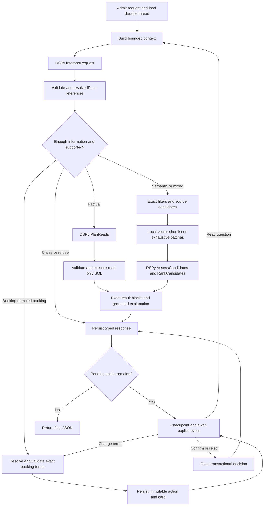

# Architecture and end-to-end flows

Status: owner-selected architecture, consolidated on 2026-10-31; implementation present; known-case model evidence
recorded in [evaluation](../evaluation/README.md).
[Decisions](../decisions/README.md) distinguish accepted policy from engineering defaults.

## Components and trust boundaries

| Component | Owns | Boundary |
| --- | --- | --- |
| React chat | Saved-chat sidebar, API history, typed blocks, explicit decisions | No credentials, sole transcript copy, SQL execution or optimistic booking success |
| FastAPI/Pydantic | Typed contracts, request identity, per-thread admission, history/readback | Does not accept new booking terms in Confirm or expose arbitrary query endpoints |
| LangGraph StateGraph | Intent routing, clarification, reads, semantic batches, pause/resume | Controlled paths and local retry budgets; no free tool loop |
| DSPy modules | Interpretation, read planning, assessment/ranking, explanation, summary | Every generative call typed; outputs remain untrusted proposals |
| Structured reader | Allowed source reads, limits and executed provenance | Separate read-only connection, explicit schema/function allowlists |
| Semantic index | Local vectors and source memberships | Derived cache; similarity does not establish exact facts or exhaustive totals |
| Fixed booking writer | Immutable actions and transactional soft insert/receipt | No model-authored writes; no source updates/deletes |
| Working subject SQLite | Copied subject data, confirmed bookings, booking_actions | Original input remains immutable; writer transactions are short |
| App SQLite | Threads, requests, full transcript, checkpoints, local index | Private tables never exposed to model SQL |

Single backend worker, independent per-thread operations. Blocking SQLite/provider work
must run off the event loop or through supported async integration. Locks serialize one
thread only, not every chat. The process is local by default; thread UUIDs are identity
references, not authentication. There is no multi-user security claim.

## Backend module boundaries

Owner approved the synchronous SQLAlchemy refactor on 2026-11-01. The public HTTP
contract, eight graph node names and dictionary checkpoint fields remain unchanged.

| Package | Responsibility | Boundary |
| --- | --- | --- |
| [app](../../src/resourcing_assistant/app.py) | Compose dependencies and own lifespan | Services receive dependencies instead of constructing storage/model clients |
| [config](../../src/resourcing_assistant/config.py) | Validated pydantic-settings, aliases, secrets and resource budgets | Explicit dotenv loading does not mutate the process environment; invalid dates/limits fail before startup |
| api | Routes, public schemas, error responses and answer-block construction | HTTP models are separate from model-task schemas and ORM records |
| agent | Stable graph, state, ContextBuilder, ReadService and ReadPolicy | Graph delegates context/SQL work; one shared read-plan repair owner |
| llm | DSPy signatures, chat transport, embedding client and token accounting | Secrets are revealed only at SDK/subprocess credential boundaries; source text remains untrusted |
| services | Conversation admission/recovery, BookingService, RetrievalService and SourceDocuments | Business workflows do not execute ad hoc SQL or create database tables |
| db | Synchronous ORM repositories, fixed source Core queries, owned schema setup and protected native reader | Session per operation; no shared Session or writer transaction across a model call |
| domain | UTC periods, durations and capacity rules | Pure calculations independent of settings, HTTP and persistence |
| evaluation | CLI runner, scoring and run-bound review | Oracles remain outside inference |

App history/actions/cache use synchronous SQLAlchemy ORM; fixed source queries and the
booking INSERT use Core. Source tables are reflected without schema creation or edits.
Only owned auxiliary tables are created when absent; existing schemas/data are preserved
and incompatible owned-column layouts fail explicitly. This refactor needs no destructive
migration. LangGraph continues to own its saver tables through SqliteSaver.

Model-authored SQL runs only in the native reader: read-only URI, authorizer, progress
handler and result limits are retained. A writer session obtains BEGIN IMMEDIATE before
reading an action; booking and receipt commit together. API routes remain synchronous
and execute blocking operations in the framework thread pool; this is not an async migration.

Document facts are read in one snapshot using three SELECTs for people, two for projects
and one for risks, including all requested eligible entities. Tests compare every document
against pre-refactor source digests. Vector/cache and embedding transport are injected
separately, so cache, outages and fallback can be tested without patching Azure internals.

## Graph overview

The read-question edge preserves the action and returns to the waiting stage after
answering. It does not overwrite the booking with the latest factual task. Interrupt
handling and node-replay details are in [agent](../specs/agent.md).

## Factual walkthrough

Example: EMEA people with Python >=4, less than 60% hard-booked in March-May 2026.

1. Admit stable request_id, save one user message and load this thread's exact context.
2. Interpret filters/period. Deterministic helpers normalize UTC `[March 1, June 1)`
   and compute 65 weekdays ×8h =520h under the disclosed capacity convention.
3. PlanReads receives compact allowed schema, domain/grain/unit rules and bound inputs.
4. Reader validates and executes successful SELECTs. Aggregate full minutes for hard
   bookings intersecting the period, include CMP, exclude soft, preserve zero-booking
   people and apply strict `<60%`. One bounded planner repair is permitted.
5. Code builds exact rows/metrics and SQL blocks. ExplainResults can explain evidence,
   but cannot replace arithmetic. Persist displayed IDs/order for follow-up.
6. If explanation fails, return verified rows/SQL with a partial-response issue. If a
   requested query fails, identify the missing portion; do not silently omit it.

## Semantic walkthrough

Example: suitable data engineers for a migration, or all active healthcare/pharma
projects with staffing/key-person risk.

1. Interpret exact filters and semantic criteria; choose shortlist or exhaustive mode.
   Clarify an undefined threshold if an exact count materially depends on it.
2. Execute source reads to establish eligible entities and original text/evidence.
3. Shortlist mode uses local vectors as candidates, then chat assessment. Exhaustive
   mode visits every eligible candidate in token-bounded batches; top-k cannot certify
   a full set. Duplicate risk vectors expand to every source membership.
4. Project criteria are decomposed by PlanProjectChecks into summary/industry and risk
   checks. Deduplicated fields are assessed separately and joined by parent identity,
   preserving required AND/OR and exact risk membership.
   AssessCandidates returns match/no_match/uncertain plus source references. Validate
   returned IDs/spans, then RankCandidates orders accepted IDs with reasons.
5. Join exact levels, roles and other values from source. Render ranked grounded rows,
   coverage and criteria. Persist the displayed order.
6. If embeddings are unavailable after bounded attempts, scan eligible original texts
   with the chat assessment path. Log degradation, warn in UI and record recovery.
   Successful full coverage can still be a complete answer. Chat failure remains an
   honest error/partial result, not a keyword-only or canned-answer substitute.

## Booking walkthrough

Example: Amanda Evans, ENG-2026-0001, 40h during April 2026.

1. Interpret/resolve person 1 and project 1; validate 2400 minutes and inclusive visible
   April 1-30, stored as `[April 1, May 1)` UTC. Audit time is real UTC.
2. Persist a stable action and exact display snapshot before returning its card. Link
   it into graph state and pause. No source booking exists yet.
3. Read questions can run while the card stays pending. Changing terms supersedes the
   old action and creates a new one. A second independent pending booking is deferred.
4. Confirm API receives action_id and decision only. In one subject-DB transaction,
   reread/revalidate, insert fixed soft/SFT row and record confirmed booking_id. Reject
   changes only the action. Neither decision needs an LLM call.
5. Reconcile transcript/checkpoint from the receipt. Repeated Confirm returns the same
   booking. A lost response or checkpoint after commit does not permit a second insert.
6. Restart restores the exact card. Mid-operation interruption uses explicit Resume;
   GET never reruns the graph/model. See [storage](../specs/storage.md) for cross-file lag.

## Why generated reads and a controlled graph

Both generated SQL and typed tool/DSL approaches were compared. Generated read-only
SQL was chosen for composable joins, grouping and new dictionary questions without
building a second query language. Its risks remain wrong joins/units/semantics; access
controls alone cannot establish correctness. Source-backed evaluation must test those.
A fixed writer remains outside this choice. A controlled graph exposes state, errors,
clarification and the critical human decision without an unrestricted agent loop.

## Evidence limits

Locked dependencies, local graph/API/SQLite checks, real process restart and Chromium
checks exist. Genuine Azure compatibility and individual model runs are recorded in
[verification](../development/verification.md); broader held-out quality and actual
Azure billing cost remain unverified. Written scenarios and [the task plan](../plans/implementation.md) remain
contracts; [verification](../development/verification.md) records actual evidence.
